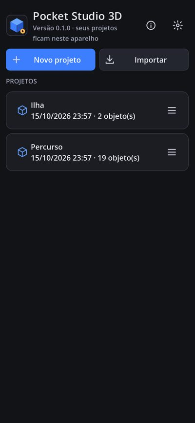
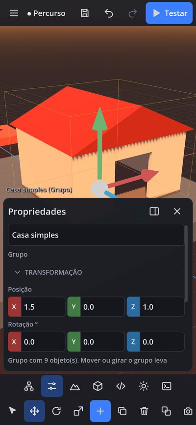
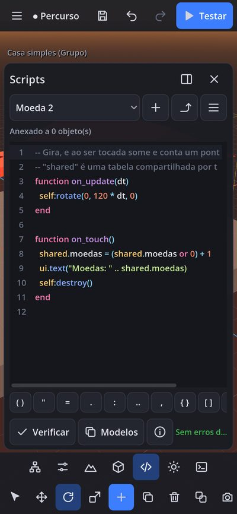
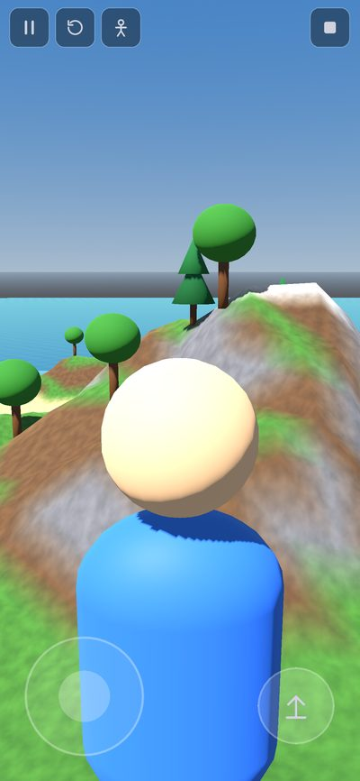

# Pocket Studio 3D

Estúdio de criação de jogos 3D **para Android**: construa mundos, edite objetos com os dedos, esculpa terrenos, importe modelos, escreva scripts e teste o jogo **no próprio celular**, sem computador e sem internet.

Feito com [Godot Engine 4.7.2](https://godotengine.org) (licença MIT), renderizador *Compatibility* (OpenGL ES 3.0) para rodar em celulares de entrada. Interface em português, tema escuro, pensada para toque.

> **Versão 0.1.0 — primeiro MVP funcional.** Tudo o que está listado como ✅ abaixo existe e é coberto por testes automatizados. O que ainda não existe está em [docs/LIMITACOES.md](docs/LIMITACOES.md).

<p>




</p>

## O que funciona

| Área | Recursos |
|---|---|
| **Projetos** | ✅ criar (4 modelos iniciais), abrir, renomear, duplicar, excluir · ✅ salvamento atômico com cópia `.bak` · ✅ salvamento automático + **recuperação após o app fechar** · ✅ versões (guarda as últimas N) · ✅ backup `.zip` (exportar/importar, validado) |
| **Editor 3D** | ✅ câmera por toque (1 dedo gira, 2 dedos arrastam e fazem pinça, toque duplo foca) · ✅ 8 primitivas + placa/parede · ✅ mover/girar/escalar com gizmo para o dedo e encaixe na grade · ✅ arrastar o objeto sobre superfícies · ✅ duplicar, excluir, seleção múltipla · ✅ desfazer/refazer (120 passos) · ✅ hierarquia com grupos, “definir pai”, ordem, visibilidade e trava · ✅ transformações por coordenadas (campo numérico com arraste e contas simples) · ✅ layout retrato e paisagem, painéis recolhíveis |
| **Modelagem** | ✅ cores, metal, aspereza, brilho, texturas importadas · ✅ agrupamento de peças · ✅ luzes (pontual/holofote), água, texto 3D, ponto de início · ✅ biblioteca interna com 12 modelos montados com peças (CC0) |
| **Terreno** | ✅ criar (32/64/128 m; plano, colinas, montanhas, ilha) · ✅ pincéis elevar/abaixar/suavizar/nivelar · ✅ pintar 6 superfícies + pintura automática · ✅ água · ✅ vegetação (árvore, pinheiro, arbusto, rocha, capim) |
| **Assets** | ✅ importar **GLB/glTF 2.0** e texturas PNG/JPG/WebP pelo seletor de arquivos do Android · ✅ validação de assinatura, tamanho, vértices e referências externas · ✅ licença, autor e origem registrados · ✅ busca e pré-visualização 3D |
| **Scripts** | ✅ linguagem estilo **Lua**, interpretador próprio **isolado** (sem acesso a arquivos, rede ou sistema) com limite de instruções · ✅ editor com realce de sintaxe, autocompletar, barra de símbolos para o teclado do celular, verificação de erros com linha · ✅ 13 modelos de script · ✅ eventos `on_start`, `on_update`, `on_touch`, `on_leave`, `on_click`, temporizadores · ✅ [API documentada](docs/SCRIPTS.md) |
| **Modo de teste** | ✅ física (fixo, dinâmico, móvel por script, sem colisão) · ✅ 1ª e 3ª pessoa · ✅ joystick virtual + câmera por toque · ✅ pular, nadar, empurrar objetos · ✅ pausar, reiniciar, voltar ao editor · ✅ erros dos scripts no console sem derrubar o jogo |

## Instalar no celular (APK de teste)

Cada envio para o GitHub roda o workflow [`.github/workflows/build.yml`](.github/workflows/build.yml), que executa os testes e gera um **APK de depuração** instalável:

1. Abra a aba **Actions** do repositório → execução mais recente de **“Testes e APK Android”**.
2. Em **Artifacts**, baixe `PocketStudio3D-…-debug-apk` (é um `.zip` com o `.apk`).
3. No celular, permita “instalar apps de fontes desconhecidas” para o seu navegador/gerenciador de arquivos e abra o `.apk`.

Requisitos: Android 7.0 ou mais novo com OpenGL ES 3.0 (arm64-v8a ou armeabi-v7a). Passo a passo completo, compilação local e assinatura de versão final em [docs/COMPILAR_ANDROID.md](docs/COMPILAR_ANDROID.md).

## Rodar no computador

1. Instale o [Godot 4.7.2](https://godotengine.org/download) (versão padrão, não a .NET).
2. Abra este repositório como projeto (`project.godot`) e aperte F5.
3. Para simular o layout de celular: `godot --path . -- --mobile --ui-scale=2.75` com a janela em tamanho de celular (ex.: `--resolution 1080x2340`).

## Testes

```bash
godot --headless --path . --import                    # primeira vez
tools/check_scripts.sh                                # todos os scripts compilam (variável GODOT = executável)
godot --headless --path . res://tests/run_tests.tscn  # 61 testes automatizados
```

Os testes cobrem dados, salvamento e recuperação, mundo, desfazer, gestos de toque simulados, gizmo, terreno, importação e validação de assets, a linguagem de scripts (incluindo o isolamento) e o modo de teste com física e scripts. Detalhes e roteiro de teste manual no aparelho em [docs/TESTES.md](docs/TESTES.md).

## Documentação

- [docs/COMPILAR_ANDROID.md](docs/COMPILAR_ANDROID.md) — gerar e instalar o APK (CI ou local), assinatura de release
- [docs/SCRIPTS.md](docs/SCRIPTS.md) — linguagem, API do jogo, exemplos e limites
- [docs/ARQUITETURA.md](docs/ARQUITETURA.md) — estrutura do código e decisões técnicas
- [docs/FORMATO_PROJETO.md](docs/FORMATO_PROJETO.md) — formato dos arquivos de projeto e backup
- [docs/TESTES.md](docs/TESTES.md) — testes automatizados e roteiro manual no celular
- [docs/LIMITACOES.md](docs/LIMITACOES.md) — limitações conhecidas e o que ainda não existe
- [docs/ROTEIRO.md](docs/ROTEIRO.md) — próximas fases (multiplayer, exportação de jogos, integrações)

## Estrutura

```
project.godot, export_presets.cfg   configuração do Godot e da exportação Android
scenes/main.tscn                    cena inicial
src/autoload/app.gd                 configurações, console, escala da interface
src/core/                           dados, armazenamento, assets, modelos, prefabs
src/world/                          mundo, primitivas, terreno
src/editor/                         editor, câmera, gizmo, gestos, desfazer, painéis
src/play/                           modo de teste, jogador, joystick
src/scripting/                      linguagem de scripts e API do jogo
src/ui/                             tema, ícones, componentes e diálogos
tests/                              testes automatizados
tools/                              utilitários de desenvolvimento (capturas, ícones)
```

## Custos e licenças

Nenhum serviço pago foi usado: Godot (MIT), GitHub Actions e bibliotecas do próprio motor. Os modelos da biblioteca interna e os ícones foram criados para este projeto (CC0).

## Aviso sobre o Roblox

O Pocket Studio 3D é um projeto independente. **Não é o Roblox Studio**, não é afiliado à Roblox Corporation, não lê arquivos do Roblox e não publica no Roblox. O motor de jogo, o formato de projeto e a linguagem de scripts são próprios. Veja [docs/ROTEIRO.md](docs/ROTEIRO.md) sobre integrações oficiais.
